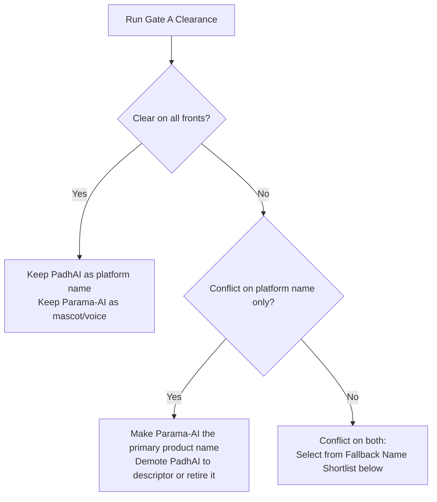

# Brand Strategy & Clearance (docs/BRAND.md)

## 1. Brand Decision (Working Names, Locked)

- **Platform Name:** PadhAI
  - *Origin:* *padhai* (study, Hindi) + *padi* (study/read, Tamil) + AI.
- **Bot / Mascot Name:** Parama-AI *(always hyphenated, capital AI)*
- **Primary Tagline:** "Study smart."
- **Secondary Line (Tamil):** "Padikka vaa. Progress panna po!"
- **Decision Status:** Creative choices locked; clearance pending (Gate A).
- **Single Source of Truth Rule:** Brand strings appear **only** in:
  - `frontend/src/brand.ts`
  - Backend configuration (`PRODUCT_NAME`, `MASCOT_NAME`)
  - `backend/app/persona/**` (persona packs)
  - `docs/BRAND.md`
  - `README.md`
  - Tests
  *All other code, prompts, and UI components must import or read from these sources.*

---

## 2. Clearance Checklist (Gate A: Complete Before Any Public Demo)

> [!IMPORTANT]
> Gate A clearance must be completed before any public demo. Do not invent or assume clearance results; verify against actual registers, registries, and stores.

### Trademark Search

| Mark | Country / Jurisdiction | Classes | Date Searched | Register Search Result | Status (Pending / Clear / Conflict) | Notes |
|---|---|---|---|---|---|---|
| PadhAI | India | 9, 41, 42 | | | Pending | |
| Parama-AI | India | 9, 41, 42 | | | Pending | |
| ParamAI | India | 9, 41, 42 | | | Pending | |
| PadhAI | Target Launch Markets | Relevant | | | Pending | |
| Parama-AI | Target Launch Markets | Relevant | | | Pending | |

### Domains

| Domain | Availability / Ownership Status | Date Checked | Estimated Cost / Renewal | Status (Pending / Available / Taken) | Notes |
|---|---|---|---|---|---|
| `padhai.ai` | Taken (known third-party) | | | Taken | Known AI exam-prep service |
| `padhai.app` | | | | Pending | Shortlisted alternative |
| `getpadhai.com` | | | | Pending | Shortlisted alternative |
| `getpadhai.in` | | | | Pending | Shortlisted alternative |
| `parama.ai` | | | | Pending | Shortlisted alternative |
| `parama-ai.com` | | | | Pending | Shortlisted alternative |

### Handles & Profiles

| Platform | Target Handle | Availability / Claim Status | Date Checked | Status (Pending / Available / Claimed) | Notes |
|---|---|---|---|---|---|
| GitHub | | | | Pending | Organization / project handle |
| Instagram | | | | Pending | |
| X (Twitter) | | | | Pending | |
| YouTube | | | | Pending | |
| Google Play Store | | | | Pending | Developer account & package name |
| Apple App Store | | | | Pending | App name reservation |
| Chrome Web Store | | | | Pending | Extension name reservation |

### Known Prior Use & Conflict Comparison

| Prior Entity / Use | Domain / Surface | Comparison & Risk Assessment | Date Checked | Resolution / Strategy |
|---|---|---|---|---|
| PadhAI (UPSC Exam-Prep app) | Android app, web (padhai.ai) | | | Evaluate confusion and category overlap |
| PadhAI (Pratham AI Reading Assessment) | Pratham reading-assessment app | | | Evaluate non-profit / commercial scope |
| "Parama, padi da" meme extension | Chrome Web Store focus extension | | | Parama-AI must be original; no meme likeness |

### Gate A Clearance Sign-Off

- **Final Platform Name:** ________________________________________
- **Final Mascot Name:** ________________________________________
- **Primary Domain:** ________________________________________
- **Reviewed & Signed Off By:** ________________________________________
- **Date Signed Off:** ________________________________________

---

## 3. Decision Tree

If clearance produces conflicts, follow this deterministic hierarchy:

1. **Clear on all fronts:**
   - Keep **PadhAI** as the platform name.
   - Keep **Parama-AI** as the bot and Study Buddy mascot name.
2. **Conflict on the platform name only:**
   - Make **Parama-AI the product name**.
   - Demote "PadhAI" to a descriptive subtitle (e.g., "by PadhAI") or retire it.
3. **Conflict on both:**
   - Pick from the **Fallback Name Shortlist** below.

---

## 4. Fallback Name Shortlist

*(Leave blank for project owner to fill during clearance evaluation)*

| # | Proposed Platform Name | Proposed Mascot Name | Domain Options | Handle Availability | Trademark Assessment | Notes |
|---|---|---|---|---|---|---|
| 1 | | | | | | |
| 2 | | | | | | |
| 3 | | | | | | |
| 4 | | | | | | |
| 5 | | | | | | |

---

## 5. Mascot Art License & Character Integrity

### Character Guidelines
- **Originality:** Parama-AI is an original character. No meme images, audio, voice, or likeness may be copied or referenced.
- **Personality:** The college senior — encouraging, playful when you procrastinate, patient when you struggle, serious during quizzes.
- **Guardrails:** Never diagnoses medical conditions or fatigue ("you might be getting tired", never "you are sleepy"). Never guilt-trips.
- **Format:** Rive state machine with inputs (`mood`, `energy`, `isTalking`, `lookX`, `lookY`) and triggers (`tap`, `wave`, `celebrate`, `stretch`, `yawn`).

### Mascot Art License Record

| Field | Record Details |
|---|---|
| **Asset Description** | Original Parama-AI character art, Rive state machine animation, and illustration assets |
| **Artist / Creator** | |
| **Creator Contact** | |
| **Date of Commission / Creation** | |
| **License Type** | *(e.g., Exclusive Assignment, Work-for-Hire, Custom Commercial, CC-BY 4.0)* |
| **Repository File Path** | *(e.g., frontend/src/assets/rive/parama.riv)* |
| **Commercial Rights** | |
| **Exclusivity & Derivative Terms** | |
| **Contract / Invoice Location** | |

---

## 6. Native-Speaker Review Log Table

*The Buddy line bank (`lines.json`) contains Tanglish and conversational regional dialogue. Every shipped line must be reviewed by a native speaker. Never ship unreviewed Tanglish.*

| Review ID | Reviewer Name | Date | Persona Pack / Language | Lines Reviewed (Scope / Range) | Result (Approved / Needs Revision) | Notes / Corrections |
|---|---|---|---|---|---|---|
| | | | | | | |
| | | | | | | |
| | | | | | | |
| | | | | | | |
| | | | | | | |

---

## 7. Rename-Proofing & Code Hygiene

To ensure that any name change remains a search-and-replace rather than a code refactor:

- **Frontend:** `frontend/src/brand.ts` exports `PRODUCT_NAME`, `MASCOT_NAME`, `TAGLINE`, and `TAGLINE_TA`.
- **Backend:** Reads `PRODUCT_NAME` and `MASCOT_NAME` from environment variables for emails, prompts, and API docs.
- **Prompt Templates:** Persona style blocks use `{{mascot_name}}` and `{{address_term}}` placeholders.
- **CI Brand Lint:** A CI check verifies that "PadhAI" and "Parama" appear ONLY in:
  - `frontend/src/brand.ts`
  - Backend config / environment
  - `backend/app/persona/**`
  - `docs/BRAND.md`
  - `README.md`
  - Test suites

---

## 8. Final Brand Audit (Phase 8 Sign-Off)

Completed prior to production deployment:

- [ ] Privacy page (`docs/PRIVACY_TEXT.md` and UI) verified to use the final cleared brand name.
- [ ] Terms of Service and legal pages verified to use the cleared brand name.
- [ ] Notification and email templates verified to read from brand configuration.
- [ ] App store listings, extensions, and metadata match cleared brand name and assets.
- [ ] CI brand lint is passing across all branches.

- **Audited By:** ________________________________________
- **Audit Date:** ________________________________________
- **Final Launch Approval:** ________________________________________
